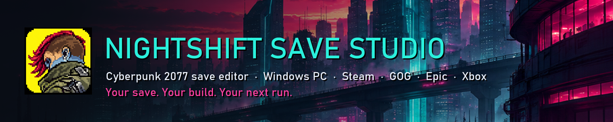
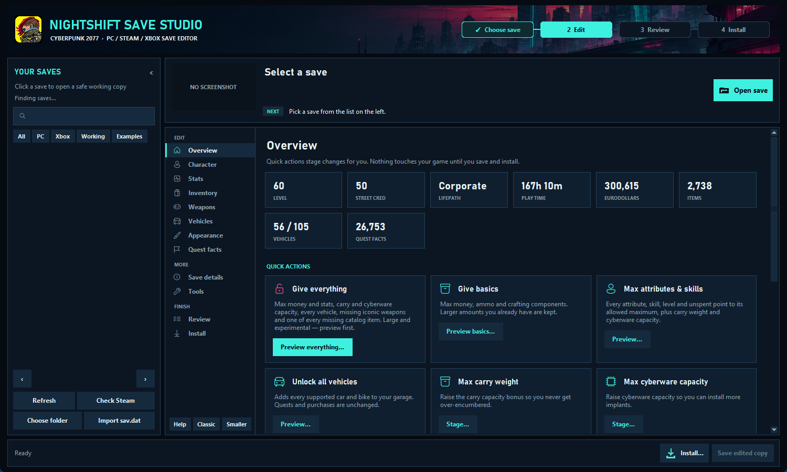
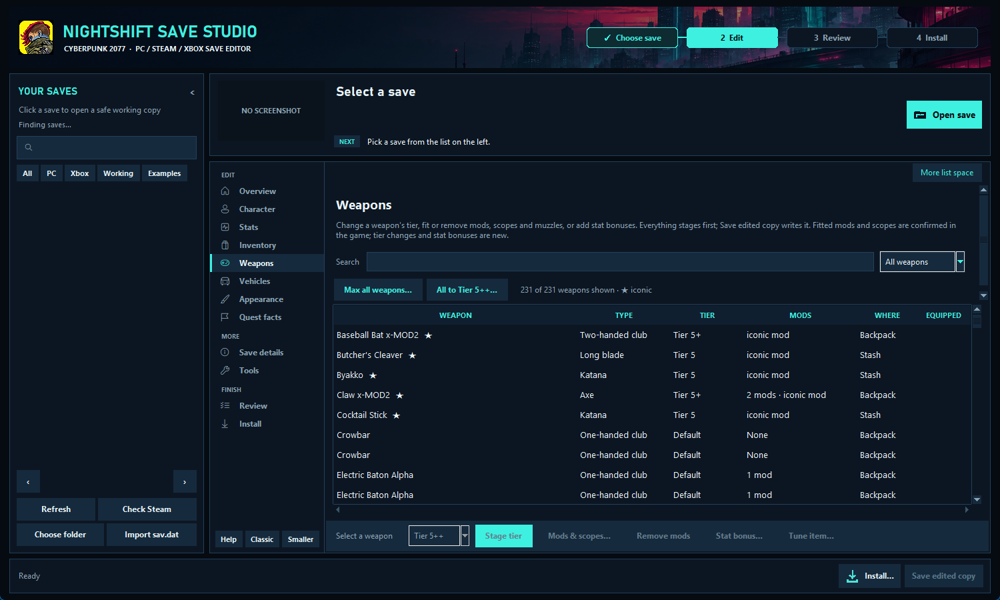
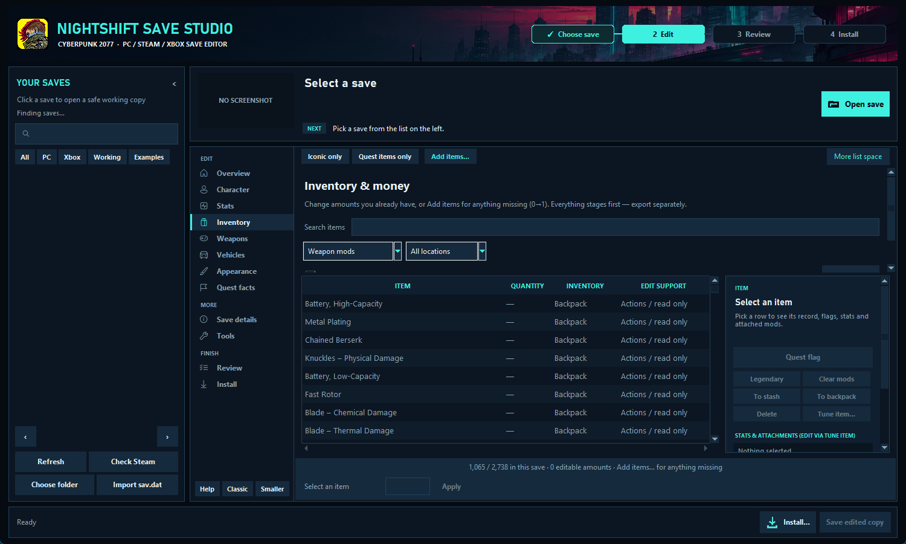
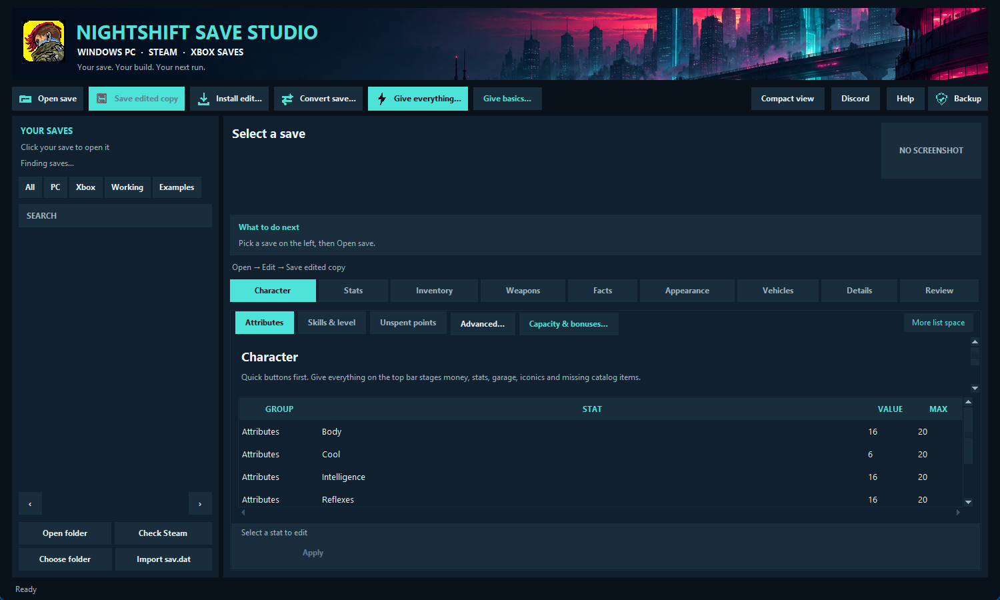
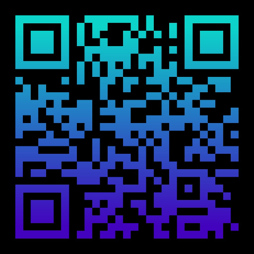

  

  
  
  
  

**Nightshift Save Studio** is a save editor for Cyberpunk 2077 that works with **Steam, GOG and Epic (Windows PC) and Xbox** saves.
Max out V, fix a build you regret, give yourself that iconic you missed, tune your guns, or move a playthrough between Xbox and PC —
without ever touching your original save. Every change goes into a fresh, verified copy that you install only when you're happy with it.

> No installer, no Python, nothing extra. Download, extract, run.

---

## ✨ What it can do

| | |
|---|---|
| 🧬 **Character** | Attributes, level, street cred, skill trees, unspent points, lifepath, perk ranks |
| 💪 **Capacity & bonuses** | Carry weight, cyberware capacity, health, stamina, armor, RAM, crit chance / damage, movement speed |
| 🎒 **Inventory** | Money, ammo, components, any of ~10,800 items from the game's own item database, delete, stash ↔ backpack, duplicate, equip |
| 🔫 **Weapons** | Tier 1 → 5++, fit or remove mods, scopes and muzzles, stat bonuses, one-click **Max all weapons** |
| ⭐ **Iconic weapons** | Add any of 115 iconics at your level, Tier 1 or Tier 5++ |
| 🚗 **World** | Every garage vehicle, fast travel points, quest-fact shortcuts (romance, Johnny), position, game clock, recipes, wardrobe |
| 🎨 **Appearance** | Voice, body type, appearance presets (export / import), cyber-arm look fix |
| 🔁 **Moving saves** | Xbox → Steam / PC and back, a copy for games without Phantom Liberty, full save-folder backups |
| 🏷️ **Load-menu message** | On Review, set the bottom caption stamped on the save's load-menu picture |

One-click bundles: **Give everything**, **Give basics**, **Max attributes & skills**, **Unlock all vehicles**.

## 📸 Screenshots

  
  

  
  

The app opens in the new layout (step tracker, save thumbnails, section badges). Prefer something simpler? The **classic** layout is one click away.

## ⬇️ Download & install

1. Grab **`NightshiftSaveStudio-1.0.2-portable.zip`** from the [latest release](https://github.com/Squ1ggs/Nightshift-Save-Studio/releases/latest).
2. Extract it anywhere (your Documents folder is fine) and run **`NightshiftSaveStudio.exe`** inside the `NightshiftSaveStudio` folder.
3. Windows SmartScreen may say the app is from an unknown publisher (it isn't code-signed). Click **More info → Run anyway**.

To update, extract a newer release over the same folder — your exports, backups and settings stay. **1.0.2** polishes Tune item (Set value) and puts the load-menu bottom message under the Review list.

## 🚀 Quick start

1. **Close the game** and give cloud sync a moment.
2. **Pick a save** on the left and click **Open save**. The app works on a copy.
3. **Edit** — quick actions on the Overview, or any section. Nothing is written yet; changes are staged.
4. **Review** your changes, undo what you don't want (Ctrl+Z), set the **bottom message on load picture**, then **Save edited copy** (Ctrl+S).
5. **Install** it: as a new Steam / PC save, over an existing one (backed up first), or into an Xbox slot.
6. Load it in game — look for your caption on the save picture.

### 🎮 Xbox saves

The Xbox app keeps saves in a synced store, so edited saves go into a slot the game made: make a new manual save in game, quit,
wait a minute for sync, then **Install → Xbox** and pick that slot. The whole Xbox profile is backed up first.

## 🛡️ Safe by design

- Your original save is never edited in place.
- Every export is re-read and compared byte for byte with what was intended before it's published.
- Installs back up first — PC slots into their `old\` folder, Xbox profiles into `Backups\`.
- Only the current save format (**277 / game build 2500**) can be edited. Older saves are shown, but editing is blocked.

## ✅ Tested in game

Confirmed by loading edited saves on **Steam and Xbox**: capacity and character bonuses (up to 999,999 carry weight), weapon tiers,
mods and scopes, stat bonuses, Max all weapons, inventory moves and equip, perks, position and clock, fast travel, Give everything,
Xbox → Steam conversion and the load-menu label. Steam → Xbox conversion hasn't been confirmed in game yet.

## ❓ FAQ

**Will this break my save?** Your original stays untouched, and installs are backed up. Still, keep your own backups — quest facts
and some catalog items can do odd things if you go wild.

**Does it work with mods?** It edits standard save data. Saves that depend on mods should be fine, but the app can't know what a mod expects.

**Why is my save "unsupported"?** It's from an older (or newer) game version. Load it in the current game and save again.

**Something went wrong.** Errors are written to `ui-error.log` next to the EXE — bring it along when you ask for help.

## 💬 Support

Questions, bugs or ideas? Leave a comment on the mod's **Nexus Mods** page, or come say hi on **Discord**:
**[discord.gg/snUvB3jcd2](https://discord.gg/snUvB3jcd2)**

When reporting a problem, mention your platform (Steam / GOG / Epic or Xbox), what you changed, and attach `ui-error.log` if there is one.

## 📄 License

© 2026 Squ1ggs. **All rights reserved.** You're welcome to download the app and use it on your own saves. Please don't copy, modify,
re-upload or reuse its code or data without permission — see [LICENSE](LICENSE). Bundled third-party components keep their own
licenses (listed in `THIRD_PARTY_NOTICES.md` inside the download).

Cyberpunk 2077 is a trademark of CD PROJEKT S.A. This project is not affiliated with or endorsed by CD PROJEKT.
